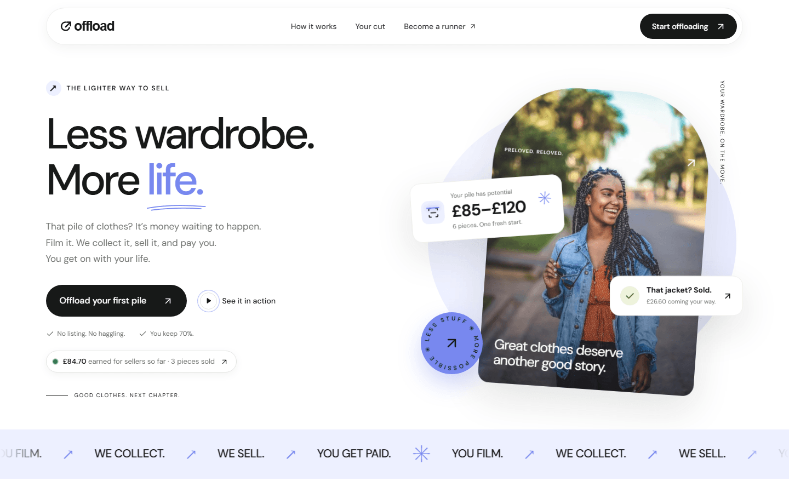
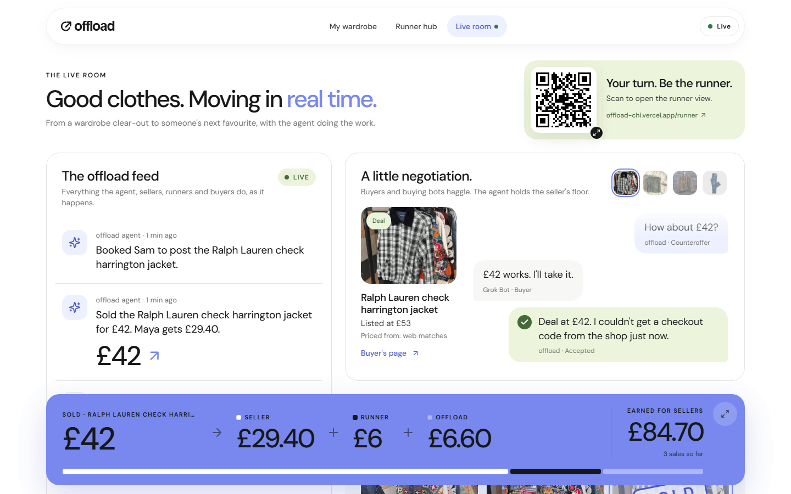
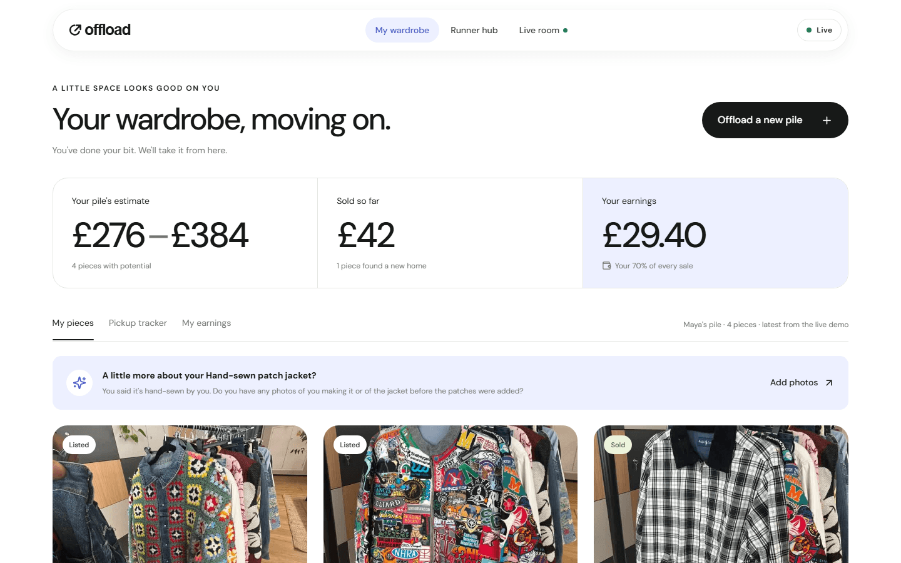
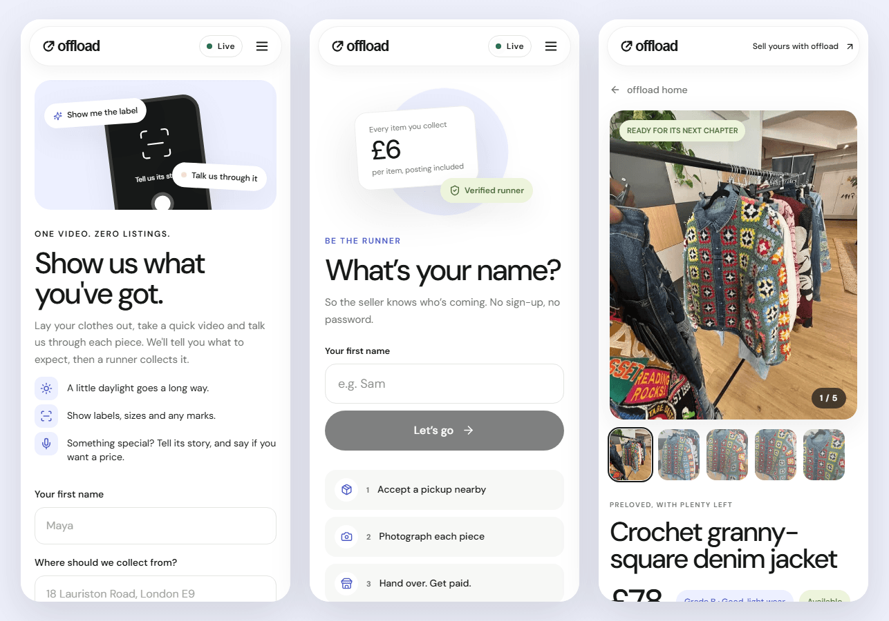
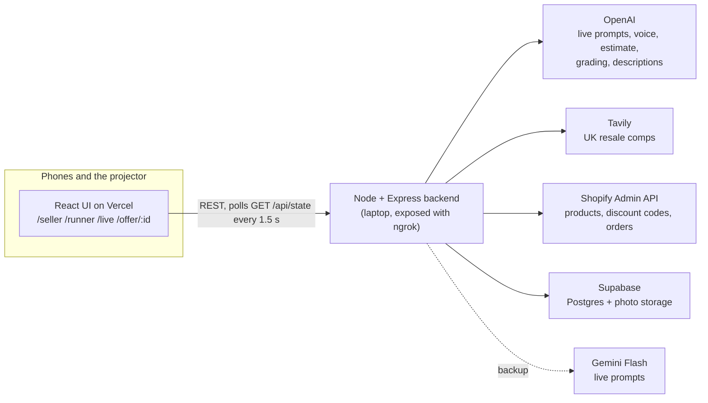

# offload

**Less wardrobe. More life.** Film your pile of clothes and talk about it. An AI agent does everything else: it estimates what the pile is worth, books a local runner to collect and photograph it, grades and prices every piece against live UK resale listings, lists it on Shopify, haggles with buyers (including AI shopping agents), and books the runner to post each sale. The seller keeps 70%.

Built in a day at **Grok Bot Commerce London** (Fleek HQ, 26 September 2026).

**Try it at [offload-chi.vercel.app](https://offload-chi.vercel.app).** The backend runs on a laptop, so it isn't always online. If a page can't load its data, add `?api=mock` to the URL (for example [/live?api=mock](https://offload-chi.vercel.app/live?api=mock)) and the whole app runs against an in-browser mock instead.



## Screenshots

| **Live room** (the projector): the agent's feed, a Grok Bot haggle and each sale's money split | **Seller dashboard**: the pile estimate, what's sold, earnings and every piece |
|---|---|
|  |  |

**On the phone:** the seller filming their pile, the runner's first screen, and the buyer's offer page.



## How it works

1. **Film.** The seller films the pile on their phone and talks about each piece. A fast vision model watches one frame every couple of seconds and prompts them ("Show me the label", "Any marks or damage?"). Their voice is recorded and transcribed on the server.
2. **Estimate.** The agent reads the frames and the transcript. It returns every item with the seller's own story, any claim ("hand-sewn", "signed by…") and any price they asked for, plus a price range for the whole pile.
3. **Collect.** A runner accepts the pickup, collects the pile and photographs each piece. Anyone can be the runner by scanning the QR code on the live screen. The agent checks the photos and asks for a retake when something is missing or blurry.
4. **Grade and price.** Each piece gets a grade from A to D and a price from live comparable listings on eBay UK, Depop and Vestiaire. When the web has nothing similar, the rules stay honest:
   - The seller's own price always wins.
   - With no matches, a base table sets the price and the agent asks the seller what they'd want.
   - A claim only appears on a listing when a close-up photo backs it up.
5. **List.** Every piece becomes a Shopify product with its photos, a description in the seller's own words, and a "Make an offer" link.
6. **Haggle.** Buyers and shopping agents like Grok Bot make offers. The agent accepts at or above the floor, counters once at the midpoint, and never goes below what the seller will take. An accepted offer gets a one-use Shopify discount code.
7. **Sell and post.** The backend checks Shopify for new orders every 5 seconds. Each sale splits **70% to the seller, a flat £6 per item to the runner (collection and posting), and the rest to offload**, and the runner is booked to post it.

## Architecture



- **Frontend** (repo root): React 19, TypeScript, Vite, Tailwind v4 and Motion. One app with a phone layout for sellers and runners and a desktop layout for the projector.
- **Backend** (`server/`): Node + Express in plain JavaScript. State lives in memory so polling is instant, and every change is written through to Supabase. Every model or network call has a short timeout and a plain fallback, so the demo never stalls.
- **The models:** OpenAI `gpt-5.4-mini` handles the estimate, grading, comps filter and descriptions. `gpt-5.4-nano` handles live filming prompts in under a second, with Gemini Flash as its backup. If an Anthropic key is set, Claude Sonnet takes over the estimate, grading and descriptions.
- **The contract** between the two halves (data shapes and routes, all money in integer pence) is in [`server/CLAUDE.md`](server/CLAUDE.md) and mirrored in [`src/types.ts`](src/types.ts).

## Run it locally

You need Node 20 or newer, and pnpm for the frontend.

**Backend:**

```sh
cd server
npm install
cp .env.example .env     # add the keys you have; a missing key falls back instead of crashing
npm start                # http://localhost:8787
```

Run `server/schema.sql` once in the Supabase SQL editor to create the tables and the public `photos` bucket. The full backend runbook is [`server/README.md`](server/README.md): every service, the fallbacks, the Shopify scopes and the checks.

**Frontend**, from the repo root:

```sh
pnpm install
cp .env.example .env.local    # VITE_API_BASE=http://localhost:8787
pnpm dev                      # http://localhost:5173
```

**No backend or no keys?** Leave `VITE_API_BASE` empty, or open any page with `?api=mock`. An in-browser mock then answers every route from `public/mock/`.

## Running the stage demo

Open `/live` on the projector. These hidden keys drive the scripted demo. They're ignored while you're typing or holding a modifier key.

| Key | What happens |
|---|---|
| `E` | The demo pile appears with its estimate |
| `P` | The runner collects and photographs everything. One item needs a retake. |
| `P` again | The retake lands and that item is graded |
| `S` | Everything lists, Grok Bot haggles, the sale lands and the money splits |
| `M` | Opens the full-screen money view |
| `0` | Resets to the seed data |

Each step fast-forwards anything that hasn't happened yet, so `S` works on its own. The demo reads a pre-computed pile from `server/cache/demo.json`: real photos and transcripts, run through the same pipeline and cached so the stage demo never waits on a model. To rebuild it from new footage, run `node scripts/build-demo-cache.js` from `server/`.

## Configuration

The frontend reads these at build time, from `.env.local` or the Vercel project settings:

| Variable | What it does |
|---|---|
| `VITE_API_BASE` | Backend URL without `/api`. Empty means the in-browser mock. |
| `VITE_USE_MOCK` | `true` forces the mock even when a backend URL is set. |
| `VITE_PUBLIC_URL` | Public address of the UI. The runner QR on `/live` points at `<this>/runner`. |
| `VITE_SHOP_PASSWORD` | Shown next to the checkout link while the Shopify dev store is password-protected. |

You can also switch backends at runtime. Opening any page once with `?api=https://your-backend.example` makes that browser use that backend from then on. `?api=mock` switches to the mock, and `?api=clear` forgets the override. The runner QR carries the override, so judges' phones reach the same backend as the projector.

The backend's variables are documented in [`server/.env.example`](server/.env.example).

## Tests and checks

```sh
pnpm test                                     # 32 frontend tests: money, pay rules, demo keys, the full mock flow
pnpm typecheck
cd server && node scripts/validate.js         # seed data matches the contract and the pricing rule
cd server && node scripts/smoke.js http://localhost:8787   # every route end to end (resets state first)
```

## Project layout

```
src/                 React app
  types.ts           the API contract, typed
  lib/               API client (real or mock), polling state, selectors, money, media capture
  components/        shared UI and the motion system
  pages/             landing, seller, runner, live room, buyer page (each with its own CSS)
public/              brand assets, hero image, mock data
server/              Express backend
  src/               routes, flows, pricing, and one adapter per service
  mock/seed.json     the reset state, also the UI's mock data
  cache/demo.json    the pre-computed demo pile
  scripts/           smoke test, validator, demo-cache builder, photo uploader
  schema.sql         Supabase tables and the photo bucket
docs/                original brief, design notes, build notes, screenshots
tests/               frontend tests
```

## Deploying

- **UI:** Vercel with the Vite preset and the repo root as the project root. `vercel.json` rewrites every path to `index.html`, so `/runner` and `/offer/<id>` open directly from a QR code or a Shopify listing.
- **Backend:** runs anywhere Node runs. At the event it ran on a laptop behind an ngrok static domain. Set `UI_BASE` in `server/.env` to the UI's URL so every listing links back to its offer page.
